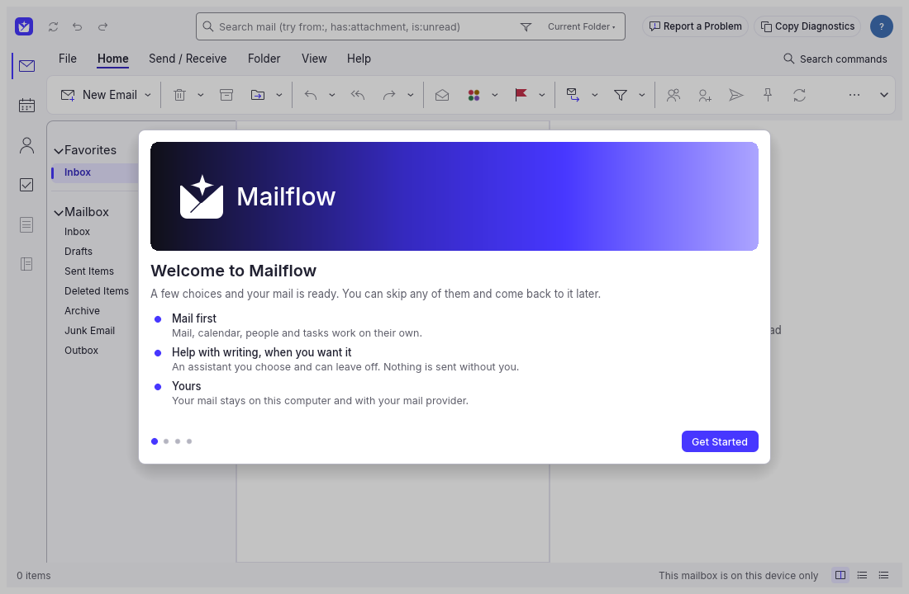
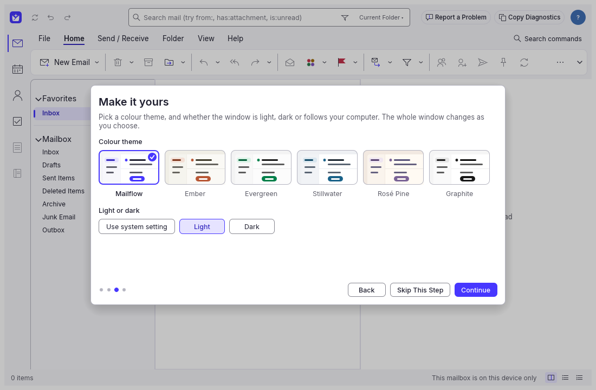
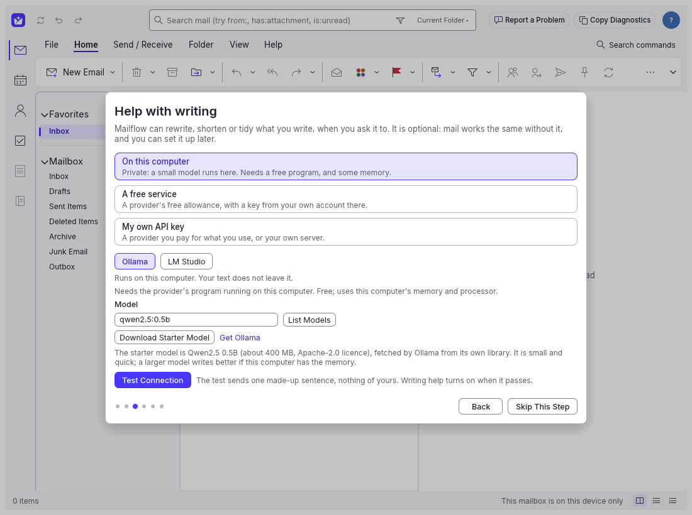
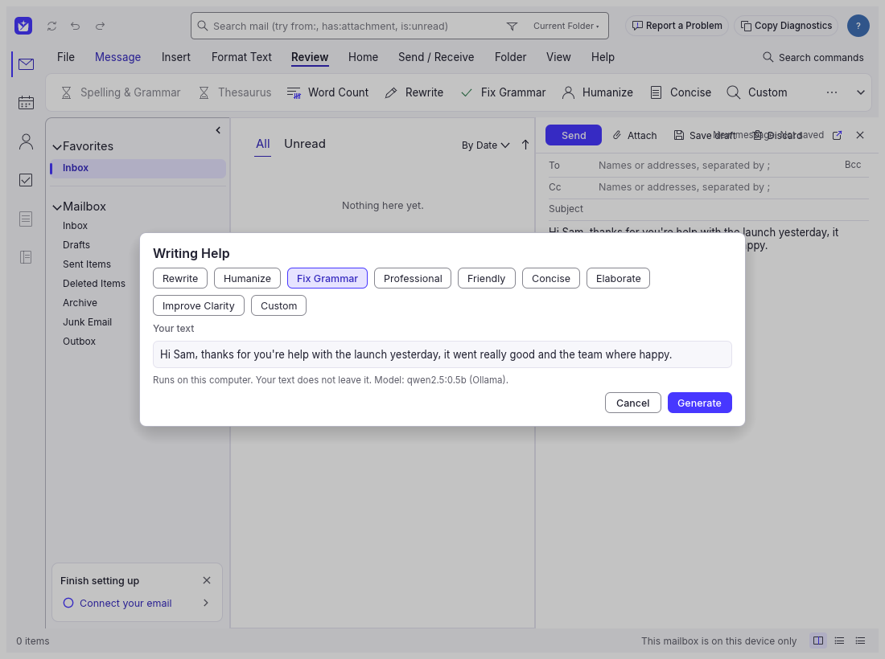
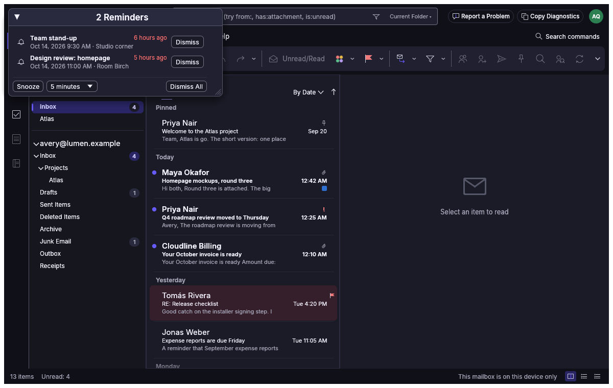

<div align="center">
  
  <h1>Mailflow</h1>
  <p><strong>A free, open source mail, calendar, contacts and tasks app for Mac and Windows, with optional help with writing from an AI model you choose.</strong></p>
</div>

> Mailflow is a fork of [MailCraft](https://github.com/UCS-Care-Group/mailcraft) by UCS Care Group and the MailCraft contributors, an open source project under the MIT License or the Apache License 2.0. Thank you to the MailCraft authors and contributors for the mail engine and the foundation this app is built on. Mailflow is not affiliated with or endorsed by the MailCraft project.

Mailflow is a native desktop mail program: mail, calendar, people and tasks in one window, with the ribbon, folder pane, message list and reading pane people already know. On top of MailCraft it adds a guided setup, colour themes, and help with writing that runs only when you ask for it, on your own computer or with a provider you pick.



## Why Mailflow?

- **Free**: no subscription, no account with us
- **Mail first**: everything works with help with writing switched off, which is how it starts
- **Your choice of AI, or none**: a small model on your own computer, a provider's free allowance, or your own API key
- **Private**: your mail stays on your computer and with your mail provider. Nothing is sent to an AI provider unless you press the button for it, and the window says where the text is going first
- **Open source**: built on MailCraft, and its changes are open in the same way

## Features

**Mail, calendar, people and tasks** come from MailCraft: Microsoft 365, Outlook.com, Gmail and IMAP accounts, conversations, flags, categories, rules, a calendar with recurring meetings, contacts and to-dos. See [README.mailcraft.md](README.mailcraft.md) for the full list.

**What Mailflow adds:**

- **A guided setup** on first start: connect your email, set up help with writing, choose a look. Every section has its own Skip, and what you skipped waits in a "Finish setting up" card
- **Six colour themes**, each in light and dark: Mailflow, Ember, Evergreen, Stillwater, Rosé Pine and Graphite, all checked for readable contrast
- **Help with writing** while you write a message: Rewrite, Humanize, Fix Grammar, Professional, Friendly, Concise, Elaborate, Improve Clarity, or your own instruction. You see your text and the suggestion side by side, and nothing changes until you accept it; Undo brings your own words back
- **Writing preferences**: tone, length, language and your own standing instructions
- **Your key stays yours**: API keys go in the macOS Keychain or Windows Credential Manager, never in a settings file

| | |
|---|---|
|  |  |
|  |  |

### Help with writing: where it can run

| Where | Providers | What you need |
|---|---|---|
| On this computer | [Ollama](https://ollama.com), [LM Studio](https://lmstudio.ai) | The provider's free program. Your text does not leave the computer |
| A free service | Groq, Google Gemini, OpenRouter | A key from your own account there. Free allowances are the provider's and can change |
| Your own API key | OpenAI, Anthropic, NVIDIA NIM, or any OpenAI-compatible server | A key, billed by the provider for what you use |

With Ollama, Mailflow can have it fetch a small starter model (Qwen2.5 0.5B, about 400 MB, Apache 2.0). It is quick and light; a larger model writes better if your computer has the memory.

## Download and install

**There are no installers yet.** Mailflow is in early development and its first release is being prepared. Until then you can [build it yourself](#build-it-yourself). When installers are published they will be on the [Releases page](https://github.com/reachneoagent-commits/mailflow/releases), for macOS (Apple Silicon and Intel) and Windows.

Mailflow will not be signed with a paid Apple or Microsoft certificate, so your computer will warn you the first time you open it. The steps to get past that will be here with the first release.

## Build it yourself

You need [Rust](https://rustup.rs/) 1.95 or newer. Building from source avoids the unsigned-app warning, because your own computer made the app.

```bash
cargo run --release -p mailcraft
```

To try it on an invented mailbox without adding an account:

```bash
cargo run --release -p mailcraft -- --sample
```

To build the macOS app and disk image:

```bash
bash packaging/macos/package.sh --arch universal
```

The crates and the program keep MailCraft's names (`mailcraft`, `mailcraft-*`) so that changes from MailCraft keep merging cleanly; the window, the app and its data folders say Mailflow.

## Status

Early and not yet released. What to know before relying on it:

- Signing in to Microsoft and Google accounts still goes through MailCraft's app registrations, so their sign-in pages say "MailCraft"
- Mailflow does not update itself yet
- The Windows installer has not been built or tested
- Help with writing has no streaming, and a model download through Ollama shows no progress bar

## About this fork

Mailflow's mail engine, protocols, calendar, contacts, tasks and interface come from MailCraft. The original MailCraft README is kept in [README.mailcraft.md](README.mailcraft.md), its notice is kept unchanged in [NOTICE](NOTICE), and the upstream project is at <https://github.com/UCS-Care-Group/mailcraft>. Mailflow is based on MailCraft 0.12.0.

Problems with Mailflow belong in [this repository's issues](https://github.com/reachneoagent-commits/mailflow/issues), not MailCraft's.

### Credits

- **[MailCraft](https://github.com/UCS-Care-Group/mailcraft)** by UCS Care Group and the MailCraft contributors: the whole mail, calendar, contacts and tasks program this app is built on (MIT or Apache 2.0).
- **[WordCraft](https://github.com/storytold/wordcraft)** by the ArtCraft Team and the WordCraft contributors: the architecture and tooling MailCraft itself started from (MIT or Apache 2.0).
- **[tweakcn](https://tweakcn.com/community)** community themes, which the colours of five themes started from: "Claude +" and "Minimal Neutral" by Luis Llanes, "Better Light Theme Supabase" by Alexeeey, "Stillwater" by Sushmoy Roy, and "Rose Pine" by Rudra Patel (after the [Rosé Pine](https://rosepinetheme.com) palette).
- **Inter**, **Source Sans 3** and **JetBrains Mono**: the interface fonts (SIL Open Font License 1.1).

Every bundled asset is listed with its author and licence in [ATTRIBUTION.md](ATTRIBUTION.md).

## License

MIT License or Apache License 2.0, at your option. See [LICENSE-MIT](LICENSE-MIT) and [LICENSE-APACHE](LICENSE-APACHE). Mailflow is a derivative work of MailCraft, Copyright (c) 2026 the MailCraft contributors. The "MailCraft" name and marks are not used as Mailflow branding, and the Mailflow name, mark and app icon are its owner's brand and are not covered by the open source licence (see [NOTICE](NOTICE)).
